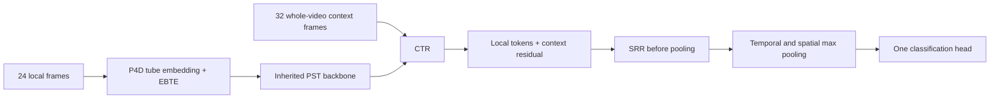

# Implementation map

All reported results use the default 408,682-parameter model. Historical state-dictionary keys are preserved so that a reorganized file layout does not change checkpoint interpretation.

| Component | File | Parameters in this release |
|---|---|---:|
| Inherited tube projection + PST transformer + classifier | `model/backbone.py` | 276,690 |
| EBTE additions | `model/ebte.py` | 3,200 |
| CTR, including content reading | `model/ctr.py` | 119,672 |
| SRR | `model/srr.py` | 9,120 |
| Total | | 408,682 |

The P4D tube extractor and PST temporal attention belong to the inherited backbone. The three named additions are EBTE, CTR and SRR.

## EBTE

EBTE wraps the local P4D tube embedding. It forms temporal phase contrasts from the existing three-frame neighborhood, reads them through rank-10 projections and adds a learned residual. The residual is bounded by raw local phase energy; the energy budget is detached so the model cannot increase its residual allowance merely by differentiating through that allowance. The implementation includes numerically stable limiting and finite-precision checks. Its exact contrast definitions and bound are in `raw_phase_evidence`, `bound_residual_with_phase_energy`, and `EnergyBoundedTrendEncoding`.

The inherited tube projection contributes 320 parameters, and the EBTE projections add 3,200. The resulting local feature width is 80. Spatial subsampling produces 64 anchor points per frame; temporal stride two produces 12 anchor frames for a 24-frame input.

## CTR

CTR follows the PST transformer and precedes SRR and global pooling. It encodes each context frame using a point MLP and pooled frame features, adds continuous time information, and uses two temporal attention blocks at width 64 with four heads. Each local time/point token reads its own context residual.

This release includes both the inherited geometric/time-conditioned reading path and a distinct content-reading path. The content path uses the difference between an actual frame encoding and a **zero-geometry reference encoding produced by the same encoder**. The reference is not the video's temporal mean and is not detached. Keys and values therefore carry frame-content evidence rather than a time template alone. Relative-time terms use signed, absolute and squared time differences.

The two reading residuals have separate zero-initialized output projections and are added to the local tokens. Context keys represent frames; the implementation does not claim tracked body-part correspondences. Local/context coordinates are aligned using the dataset's explicit scale and offset metadata.

## SRR

SRR operates on the 80-channel tokens immediately before temporal/spatial max pooling. Within each frame, it finds the eighth-nearest squared distance in float32, excludes self edges and retains **all ties** at that threshold. A mask and the actual neighbor count handle variable neighborhood sizes.

For center and neighbor tokens \(u_i,u_j\), aligned positions \(p_i,p_j\), and LayerNorm \(\ell\), the edge vector is

\[
e_{ij}=[\ell(u_i),\;\ell(u_j)-\ell(u_i),\;p_i,\;p_j-p_i]\in\mathbb R^{166}.
\]

A 166→32→32 GELU MLP encodes each edge. Valid-edge means are projected through a bias-free, initially zero 32→80 layer to obtain \(R\). The final residual is bounded per token:

\[
\tau_i=0.02\,\operatorname{stopgrad}\!\left(\sqrt{\frac1{80}\sum_cu_{ic}^2}\right)+10^{-6},
\qquad y_i=u_i+\tau_i\tanh(\alpha R_i/\tau_i).
\]

The code computes RMS with a stable rescaling. Training uses \(\alpha=1\); the released inference configuration uses \(\alpha=0.5\). During the SRR phase, parent features and classifier weights are frozen. The classifier operation still participates in backpropagation so that gradients reach SRR through the residual and pooling.

## Switches and inference state

`config/switches.py` exposes only `ebte`, `ctr` and `srr`. All eight combinations are tested for model construction and forward shape. The supplied full checkpoint requires all three enabled. The exact reproduction training entry deliberately rejects an altered structure rather than silently reusing its recorded result.

`build_model` begins in the parent training phase. For the selected complete checkpoint, strict-load all 132 state tensors, call `set_phase(30)`, set SRR scale 0.5 and call `eval()`. `reproduce.py` performs these steps and verifies the checkpoint hash.
